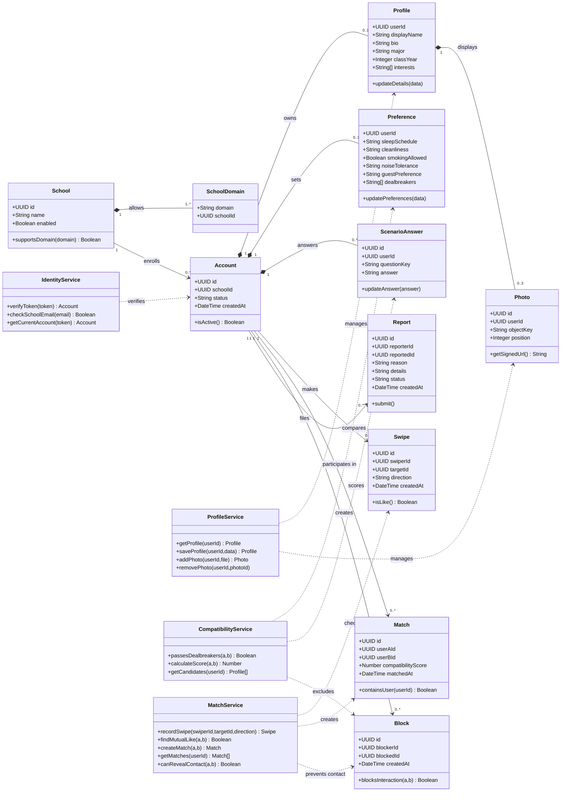

# 3. Class Diagrams

The following UML class diagram models all six must-have requirements from P1/P2. It is a **design model**, not a claim that every class exists as an ES6 class or implemented database table. The current Node.js/Express backend uses functions/services and repositories; the names below represent domain entities and service responsibilities.

**Implementation status:** School, SchoolDomain, Account, Profile and Photo correspond to tables in `backend/migrations/001_accounts_profiles.sql`. IdentityService and ProfileService correspond to implemented service modules. Preference, ScenarioAnswer, Swipe, Match, Block, Report, CompatibilityService, and MatchService are proposed for subsequent milestones.

### Class descriptions, attributes, and methods

| Class | Description and attributes | Methods / responsibility |
| --- | --- | --- |
| **School** *(existing table)* | School ID, school name, enabled flag. Represents an approved university. | `supportsDomain()` determines whether a domain belongs to the school (implemented through lookup logic, not an object method). |
| **SchoolDomain** *(existing table)* | Approved email domain and associated school ID. | No domain-specific method required; school domain mapping is queried during verification. |
| **Account** *(existing table)* | Authentication-linked user UUID, school ID, account status, creation timestamp. Passwords are managed by Supabase Auth, not stored here. | `isActive()` indicates whether the account can access the application. |
| **Profile** *(existing table)* | User ID, display name, biography, major, class year, interests. | `updateDetails()` changes profile information. |
| **Photo** *(existing table)* | Photo ID, owner ID, private storage object key, display position. | `getSignedUrl()` returns a temporary authorized image URL. |
| **Preference** *(planned)* | User ID; sleep schedule, cleanliness, smoking, noise and guest preferences; dealbreakers. | `updatePreferences()` saves roommate lifestyle requirements. |
| **ScenarioAnswer** *(planned)* | Answer ID, user ID, scenario question key and selected answer. | `updateAnswer()` edits responses used for roommate compatibility. |
| **Swipe** *(planned)* | Swipe ID, swiper ID, target ID, left/right direction, time. | `isLike()` checks whether a swipe indicates interest. |
| **Match** *(planned)* | Match ID, both users' IDs, compatibility score, match time. | `containsUser()` checks match membership; match creation requires reciprocal likes. |
| **Block** *(planned)* | Block ID, blocker ID, blocked user ID, creation time. | `blocksInteraction()` identifies prohibited interactions between users. |
| **Report** *(planned)* | Report ID, reporter ID, reported user ID, reason, details, review status and time. | `submit()` records a safety complaint for review. |
| **IdentityService** *(implemented as functions)* | Uses Supabase Auth, verified school domains, and account records; no persistent attributes of its own. | `verifyToken()`, `checkSchoolEmail()`, and `getCurrentAccount()` represent token verification, school eligibility and account retrieval. |
| **ProfileService** *(implemented as functions)* | Uses profile repository and photo storage; no persistent attributes of its own. | `getProfile()`, `saveProfile()`, `addPhoto()`, `removePhoto()` handle profile CRUD and photo operations. |
| **CompatibilityService** *(planned)* | Uses preferences, scenario answers, and dealbreaker rules. | `passesDealbreakers()`, `calculateScore()`, `getCandidates()` filter and score eligible roommate profiles. |
| **MatchService** *(planned)* | Coordinates swipe records, mutual matches and blocking rules. | `recordSwipe()`, `findMutualLike()`, `createMatch()`, `getMatches()`, `canRevealContact()` manage matching and contact privacy. |

### Relationship explanation

A **School** has approved **SchoolDomains** and many **Accounts**. Each **Account** can own one **Profile** and one set of **Preferences**, along with scenario answers. A **Profile** can have up to three **Photos**, consistent with the implemented backend. An account can make many **Swipes**, participate in many **Matches**, and create **Blocks** and **Reports**.

The **CompatibilityService** scores candidate profiles using preferences and scenario answers while excluding dealbreaker violations and blocked users. The **MatchService** records swipe decisions and creates a match only after both students swipe right. Contact information remains private until a valid mutual match exists. These business rules are enforced by backend services rather than trusting the frontend.

**Design note:** Attribute names and method names for planned classes are proposed interfaces and may change once their tables and endpoints are implemented. `Match` is a relationship between two accounts even though the diagram uses a single participation association for readability. In-app chat is not shown because the project documents have not finalized it as an MVP requirement.
